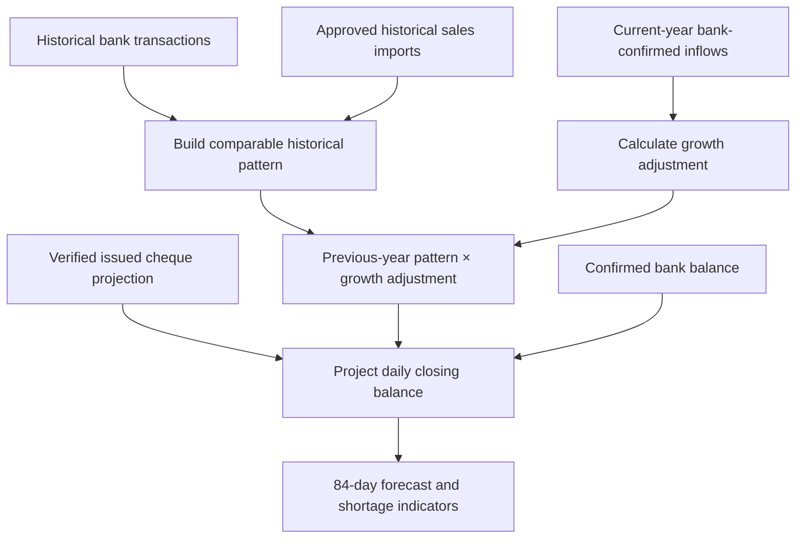
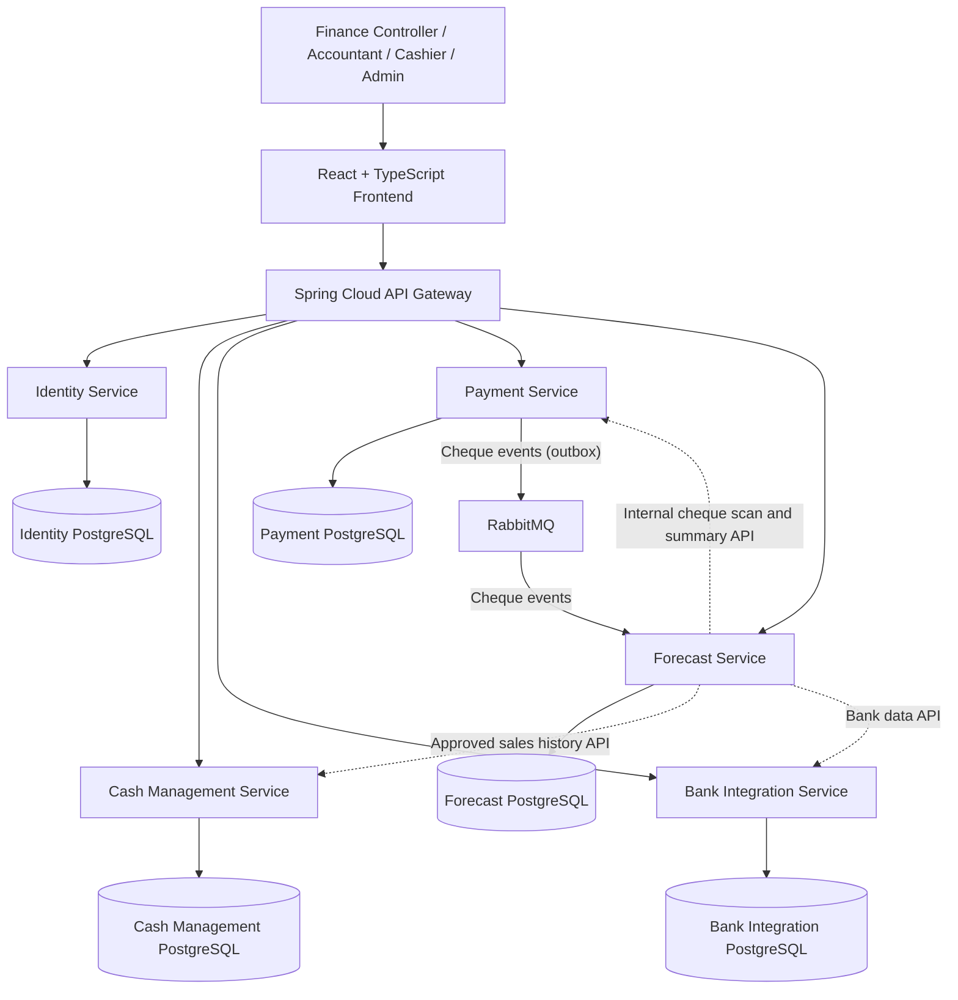

<h1 align="center">FlowLedger</h1>

<p align="center">
  <strong>Know your real bank position. Anticipate cheque payments. Plan cash with confidence.</strong>
</p>

<p align="center">
  A cash-flow coordination platform for medium-sized Sri Lankan businesses, built to help Finance
  Controllers understand confirmed bank balances, forecast upcoming cash movements, and identify
  potential cash shortages across a rolling 12-week horizon.
</p>

<p align="center">
  <a href="https://openjdk.org/"></a>
  <a href="https://spring.io/projects/spring-boot"></a>
  <a href="https://react.dev/"></a>
  <a href="https://www.typescriptlang.org/"></a>
  <a href="https://www.postgresql.org/"></a>
</p>

<p align="center">
  <a href="https://vite.dev/"></a>
  <a href="https://tailwindcss.com/"></a>
  <a href="https://maven.apache.org/"></a>
  <a href="https://www.rabbitmq.com/"></a>
  <a href="https://www.docker.com/"></a>
</p>

---

## Contents

- [Why FlowLedger?](#why-flowledger)
- [Core capabilities](#core-capabilities)
- [How forecasting works](#how-forecasting-works)
- [Architecture](#architecture)
- [Technology stack](#technology-stack)
- [Repository structure](#repository-structure)
- [Roles and access](#roles-and-access)
- [Getting started](#getting-started)
- [Configuration and security](#configuration-and-security)
- [Database and migrations](#database-and-migrations)
- [Running and verifying the project](#running-and-verifying-the-project)
- [Testing](#testing)
- [Important business rules](#important-business-rules)

<a id="why-flowledger"></a>

## 🎯 Why FlowLedger?

Businesses can have money moving through their bank account every day and still face a cash shortage
when several payments are due together. Bank balances show what is available now, but they do not
automatically explain whether upcoming cheque payments will be covered.

FlowLedger brings together bank-confirmed cash movements, approved historical sales information, and
expected cheque payments to help Finance Controllers answer three practical questions:

1. **What is the confirmed bank position?**
2. **What payments and cash movements are expected next?**
3. **Could the projected balance fall below LKR 0 during the next 12 weeks?**

FlowLedger is a cash-flow coordination and forecasting product — not a full accounting system, ERP,
payroll system, or payment-execution platform.

<a id="core-capabilities"></a>

## ✨ Core capabilities

### 💰 Daily sales and historical sales imports

- Record daily cash and card sales with a distinct sale date.
- Upload historical sales using a validated UTF-8 CSV template.
- Preview validation results and duplicate-date issues before approval.
- Require Finance Controller or Company Admin approval before historical imports become eligible for forecasting.
- Track import status and audit events.
- Keep sales records separate from bank-confirmed actual inflows.

### 🏦 Bank account and statement data

- Maintain the company's current bank account information.
- Import bank statements from CSV.
- Validate statement rows and balance sequences before accepting an import.
- Store bank transactions with explicit classifications.
- Keep transactions as `UNCLASSIFIED` unless an authorized user classifies them.
- Distinguish bank-confirmed transactions from sales-entry records.

### 🧾 Cheque payment management

- Record cheques with issue dates, amounts, and expected clearing dates.
- Track the supported cheque statuses: `ISSUED` and `CANCELLED`.
- Exclude cancelled cheques from expected outflows.
- Apply authorization checks, version checks, and audit records to supported cheque actions.
- Use the verified cheque projection before including cheque data in forecasts.

### 📈 Rolling 12-week cash-flow forecast

- Forecast an 84-day horizon.
- Estimate future cash and card inflows separately.
- Use the `PREVIOUS_YEAR_PATTERN` approach: align historical reference dates by 364 days (52 weeks)
  and adjust the pattern using comparable current-year, bank-confirmed inflows.
- Recalculate forecasts when new eligible inputs are included in a subsequent forecast calculation.
- Show data-quality warnings when the available history is insufficient or the growth ratio is
  outside the configured warning range.
- Project daily closing balances and identify potential cash-shortage dates.

### 📊 Forecast vs Actual

- Compare saved forecast expectations with eligible bank-confirmed actual movements.
- Use actual bank transaction dates for actual inflows and outflows.
- Keep imported sales records out of actual bank totals.
- Preserve saved forecast runs as historical snapshots.

### 🔐 Identity, authorization, and auditability

- Authenticate users and enforce authorization in backend services.
- Scope business access to company membership.
- Separate platform-level administration from company-level roles.
- Record audit events for supported sensitive workflows.
- Keep service data isolated behind service APIs rather than accessing another service's database
  directly.

<a id="how-forecasting-works"></a>

## 📉 How forecasting works

FlowLedger's forecast is designed to update as new confirmed financial information becomes available.
A saved forecast represents the inputs and model configuration used for that run; a later run can
reflect newer information without rewriting the historical snapshot.



### Previous-year pattern and weekday alignment

A date is compared with the date 364 days earlier, not blindly with the same month/day in the previous
calendar year. A 364-day interval preserves the weekday, helping reduce distortion when the same
calendar date falls on different weekdays across years.

Conceptually, for each eligible channel (cash or card):

```text
reference_date  = forecast_date - 364 days
growth_ratio    = comparable current-year bank inflows
                  / comparable previous-year inflows

expected_inflow = previous-year reference value × growth_ratio
```

The implementation uses decimal-safe monetary calculations and rounds final forecast amounts to two
decimal places. It does not silently treat missing data as zero or silently fall back to the previous
weekday-average strategy when required history is unavailable.

### Data-source and double-counting rules

- Bank-confirmed classified transactions determine actual inflows and outflows.
- Approved historical sales can supply historical pattern values where the applicable bank statement
  does not cover that date.
- If bank statement coverage exists for a historical date, eligible bank data takes precedence over
  imported sales for that date.
- Sales records and their corresponding bank deposits must not be counted twice.
- `OTHER` and `UNCLASSIFIED` transactions are not automatically treated as sales or cheque payments.
- A projected closing balance below **LKR 0** indicates a cash-shortage condition.

> **Forecast assumptions:** Receipt lag, minimum comparable history, and holiday alignment are
> documented assumptions and may need business validation. The current model does not automatically
> shift forecast dates or amounts for Sri Lankan public holidays or Poya days.

<a id="architecture"></a>

## 🏗️ Architecture

FlowLedger is organized as a monorepo with a React frontend and independently deployable Spring Boot
backend services. Each service owns its data and communicates through service APIs or asynchronous
events where appropriate.



### Backend services

| Service | Responsibility |
| --- | --- |
| `api-gateway` | Front door for frontend API requests; routes requests to backend services. |
| `identity-service` | User identity, company membership, authentication, and authorization support. |
| `cash-management-service` | Daily sales and historical sales import/approval workflows. |
| `bank-integration-service` | Bank accounts, statement imports, bank transactions, classifications, and balance snapshots. |
| `payment-service` | Cheque lifecycle, authorization, audit events, and reliable event publishing. |
| `forecast-service` | Forecast calculations, saved forecast runs, forecast-vs-actual results, and cheque projection verification. |

Services do not directly query another service's database. RabbitMQ and outbox-based publishing
support asynchronous event delivery where used. Consumers must be designed for duplicate delivery.

<a id="technology-stack"></a>

## 🧰 Technology stack

| Area | Technologies |
| --- | --- |
| Frontend | React 19, TypeScript 5.8, Vite 6 |
| UI and styling | Tailwind CSS 4, shadcn/ui, Radix UI, Lucide |
| Charts and feedback | Recharts, Sonner |
| Frontend testing | Vitest |
| Backend | Java 25, Spring Boot 4.1.1, Spring Security |
| API routing | Spring Cloud Gateway |
| Build | Maven |
| Database | PostgreSQL with Flyway migrations |
| Messaging | RabbitMQ |
| Local infrastructure | Docker Compose |
| Authentication | JWT-based authentication and backend-enforced authorization |

Versions above describe the project's current stack. Check the service build files and project
configuration for the exact version required by the checkout you are using.

<a id="repository-structure"></a>

## 📂 Repository structure

```text
FlowLedger/
├── frontend/                         # React + TypeScript web application
├── backend/
│   ├── api-gateway/                  # Frontend API entry point
│   ├── identity-service/             # Authentication and memberships
│   ├── cash-management-service/      # Daily sales and historical imports
│   ├── bank-integration-service/     # Bank accounts and statements
│   ├── payment-service/              # Cheque management and events
│   └── forecast-service/             # 84-day forecast and actual comparison
├── docs/
│   ├── decisions.md                  # Confirmed rules and open decisions
│   └── FlowLedger-Final-Database-Schema-v1.md
├── compose.yaml                      # Local PostgreSQL, RabbitMQ and optional gateway
├── .env.example                      # Example configuration (copy to .env)
└── README.md
```

<a id="roles-and-access"></a>

## 👥 Roles and access

Access is enforced by backend services; hiding a frontend control is not a substitute for
authorization.

| Role | Typical responsibilities |
| --- | --- |
| `CASHIER` | Enter and view permitted daily sales information. |
| `ACCOUNTANT` | View business information, upload historical sales, and access permitted forecast and bank views. |
| `FINANCE_CONTROLLER` | Review and approve historical imports, manage cheques, and use financial forecasting workflows. |
| `COMPANY_ADMIN` | Administer company-level access and permitted company configuration, and approve historical imports. |
| `SYSTEM_ADMIN` | Administer platform-level users, roles, and system configuration, subject to business-data membership boundaries. |

Exact permissions are defined by backend authorization rules and may vary by endpoint. Always refer to
the current API implementation for authoritative access behaviour.

<a id="getting-started"></a>

## 🚀 Getting started

### Prerequisites

| Requirement | Purpose |
| --- | --- |
| Windows 11 or a compatible development environment | Local development |
| Java 25 JDK | Backend services |
| Maven Wrapper (`mvnw`) | Build and run backend services |
| Node.js and npm | Frontend development |
| Docker Desktop with Docker Compose | Local PostgreSQL and RabbitMQ infrastructure |
| Git | Source control |

FlowLedger uses Java 25. If other projects on your machine require another Java version, set
`JAVA_HOME` for the current terminal instead of changing your global Java configuration.

### 1. Open the repository

In PowerShell:

```powershell
cd D:\Projects\FlowLedger
```

### 2. Configure environment variables

Copy `.env.example` to `.env` in the repository root and supply suitable development-only values.
Docker Compose and every backend service read this file.

Do not commit `.env` or share real credentials, JWT secrets, database passwords, or internal API keys.
Do not copy production secrets into a development environment.

### 3. Start local infrastructure

From the repository root, validate the Compose configuration first, then start the containers:

```powershell
docker compose config
docker compose up -d
```

`docker compose config` validates `compose.yaml` before containers start. The API gateway container
is in the optional `gateway` profile; start only the services you need for local development.

### 4. Build and run a backend service

For example, to run the cash-management service:

```powershell
cd D:\Projects\FlowLedger\backend\cash-management-service

$env:JAVA_HOME = "C:\Tools\Java\jdk-25.0.4.1"

.\mvnw clean verify
.\mvnw spring-boot:run
```

Run each service in its own terminal and follow its configured port and environment requirements. Do
not run `clean` against a service while another process is using its build output or JAR.

### 5. Run the frontend

```powershell
cd D:\Projects\FlowLedger\frontend

npm install
npm run dev
```

Use the scripts defined in `frontend/package.json`. The local Vite development server proxies `/api`
requests to the API gateway.

<a id="configuration-and-security"></a>

## ⚙️ Configuration and security

- Store credentials in local environment configuration or an approved secrets manager.
- Use strong, unique development secrets that satisfy the service's validation rules.
- Keep internal service secrets separate from user JWT secrets.
- Do not expose internal service endpoints through the public API gateway.
- Enforce tenant membership and role permissions in backend services.
- Preserve audit trails for sensitive financial actions.
- Use additive Flyway migrations; do not edit migrations that have already been applied to shared or
  persistent databases.
- Keep bank transactions explicitly classified. Do not infer sales or cheque payments from arbitrary
  credits or debits.
- Avoid logging statement row contents, credentials, tokens, or sensitive financial data.

<a id="database-and-migrations"></a>

## 🗄️ Database and migrations

Each backend service owns its PostgreSQL database. Flyway manages schema evolution within the owning
service.

General rules:

1. A service must not query another service's database directly.
2. Cross-service relationships use identifiers and service APIs/events, not cross-service database
   foreign keys.
3. Applied migrations are immutable. Introduce a new migration for subsequent changes.
4. Review the target database and migration status before applying schema changes.
5. Never reset a database or delete development data as a shortcut for troubleshooting without
   explicit authorization and a verified recovery plan.

Flyway migration files are located under each backend module's `src/main/resources/db/migration`
directory.

<a id="running-and-verifying-the-project"></a>

## ▶️ Running and verifying the project

Use separate PowerShell terminals for services that need to run concurrently. Start infrastructure
first, then the required backend services, and finally the frontend.

Useful checks:

```powershell
# Run a backend service's tests and verification
.\mvnw clean verify
```

```powershell
# Frontend checks, from the frontend directory
npm run typecheck
npm test
npm run build
```

Run these commands from the relevant service or frontend directory. A successful build or unit test
suite does not by itself prove that all services work together; complete the relevant manual or
automated integration checks as well.

<a id="testing"></a>

## 🧪 Testing

FlowLedger testing should cover both business correctness and service boundaries, including:

- CSV parsing, invalid rows, duplicate dates, and import approval.
- Backend authorization and company/tenant isolation.
- Bank statement validation, duplicate transaction protection, and transaction classification.
- Cheque state transitions, optimistic locking, and audit behaviour.
- Reliable outbox publishing and idempotent event consumption.
- Forecast weekday alignment, growth ratios, insufficient history, and rolling 84-day calculations.
- Historical sales versus bank transaction precedence and no double-counting.
- Forecast input hashing, saved-run preservation, and Forecast vs Actual semantics.
- Frontend type checking, component tests, and production builds.

Use the actual test commands in each module's `pom.xml` and the frontend's `package.json`. Report
skipped tests separately from passed tests.

payment-service tests use their own database (`flowledger_payment_test`) and their own RabbitMQ
exchange (`flowledger.payment.test`). That way they never send events to a locally running
forecast-service, whose dead-letter queue would otherwise block every forecast. A new `payment-db`
volume creates the database automatically. For a volume created before this change, create it once:

```powershell
docker exec flowledger-payment-db psql -U flowledger_app -d flowledger_payment -c "CREATE DATABASE flowledger_payment_test;"
```

A forecast needs a completed cheque backfill. Keep `CHEQUE_BACKFILL_ON_STARTUP=true` in the local
`.env`: forecast-service then fills and verifies its cheque projection every time it starts.

<a id="important-business-rules"></a>

## 📌 Important business rules

- The forecast horizon is **84 days (12 weeks)**.
- A projected closing balance below **LKR 0** indicates a cash shortage.
- Only bank-confirmed, explicitly classified transactions contribute to actual inflows and outflows.
- Historical sales imports require Finance Controller or Company Admin approval before they are
  eligible for forecasting.
- A sale date and its bank receipt/deposit date are separate concepts.
- Approved sales history may inform the forecast pattern, but it never becomes an actual bank inflow
  by itself.
- Forecast cheque outflows use eligible `ISSUED` cheques and expected clearing dates; `CANCELLED`
  cheques are excluded.
- Past-due cheques are not automatically marked paid.
- Forecast runs are saved snapshots. New input data can produce a new run; old runs must remain
  unchanged.
- Bank holidays and Poya dates do not automatically shift forecast dates or amounts under the current
  documented rules.

---

<p align="center"><strong>Built for clearer cash-flow decisions by Sri Lankan businesses.</strong></p>
